<div align="center">

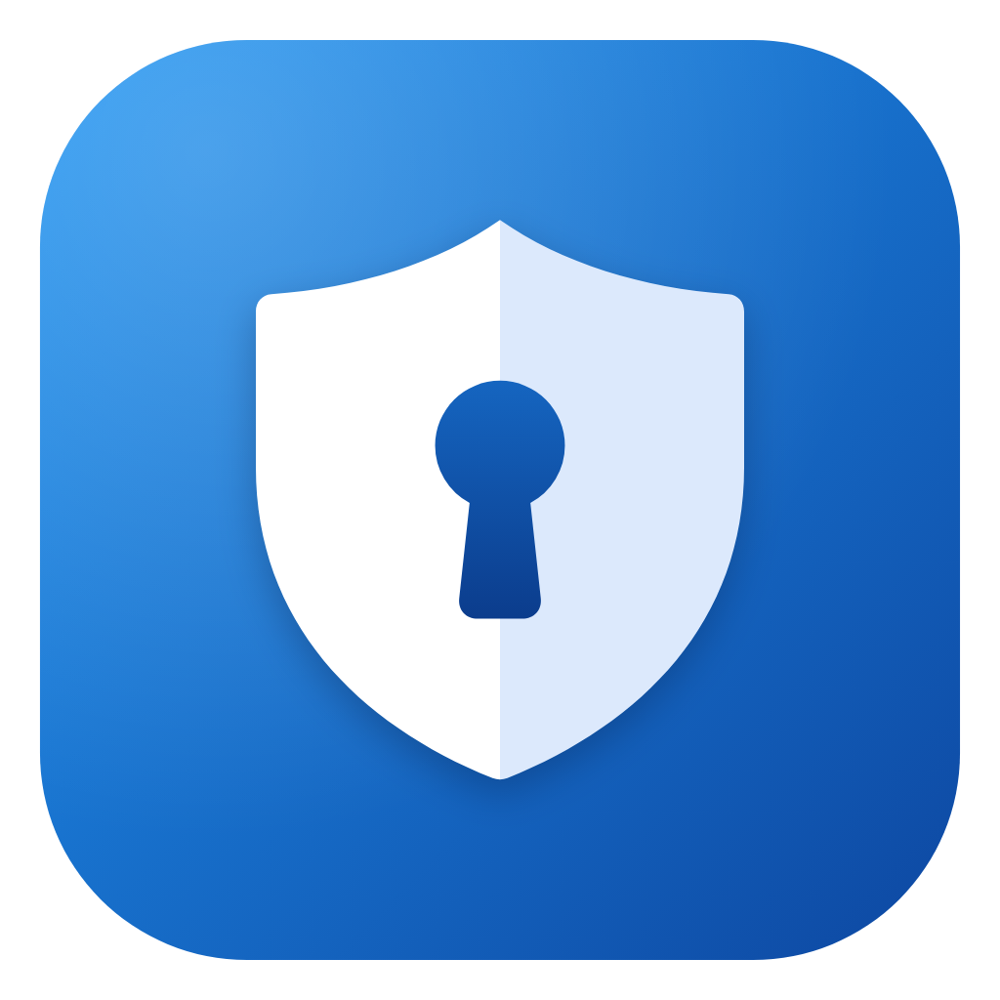

# MyVault

**A private, offline-first vault for your passwords, IDs, documents, notes and contacts.**

Everything is encrypted on your phone. No account, no server, no tracking.


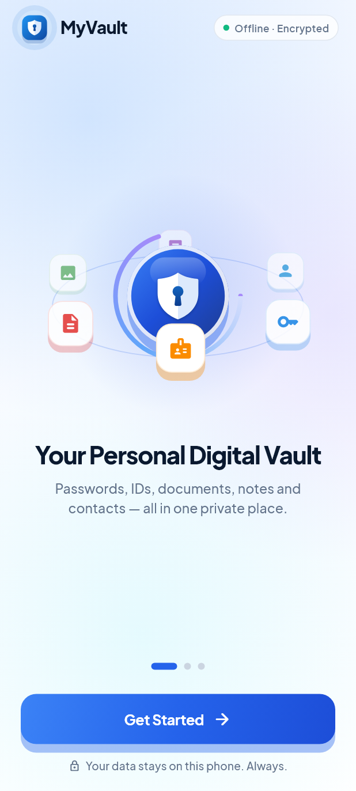
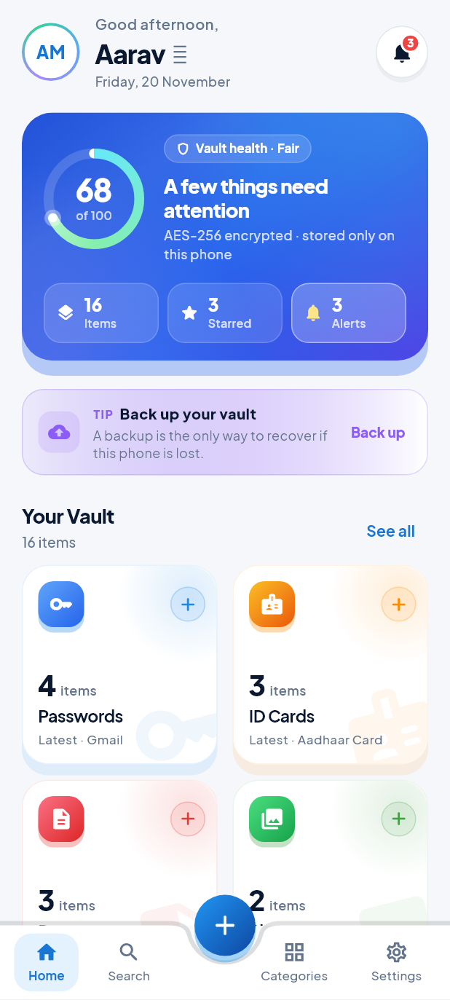
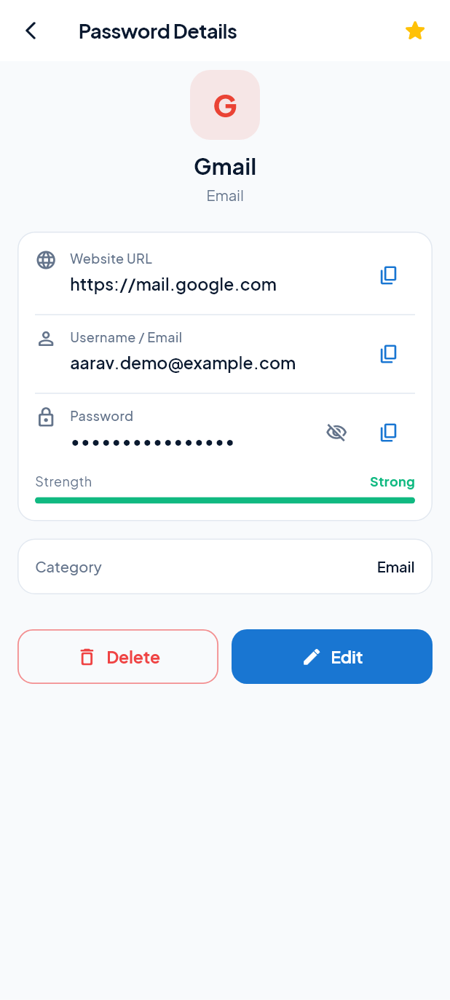

</div>

---

## Contents

- [Features](#features)
- [Screenshots](#screenshots)
- [How your data is protected](#how-your-data-is-protected)
- [Where your data lives](#where-your-data-lives)
- [Getting started](#getting-started)
- [Project structure](#project-structure)
- [Testing](#testing)
- [Documentation](#documentation)

## Features

| | |
| :--- | :--- |
| 🔑 **Passwords** | Usernames, passwords and websites, with a strong-password generator and a strength meter. |
| 🪪 **ID & bank cards** | Aadhaar, PAN, passport, licences and bank cards. Numbers are masked (`•••• 1111`) until you reveal them, and you can attach a scan of the card. |
| 📄 **Documents & photos** | Import PDFs, Office files and images. Each file is encrypted separately and shown with a preview thumbnail. |
| 📝 **Secure notes** | Recovery codes, Wi-Fi details and anything else, with **bold** formatting. |
| 👤 **Contacts** | Emergency and family contacts, with photos and `.vcf` import. |
| 🔍 **Search & favourites** | Search across the whole vault, filter by category and star the items you use most. |
| 👆 **Fingerprint unlock** | Unlocks with a key held in the Android Keystore, so the master password is never stored on the phone. |
| ⏱️ **Auto-lock** | Locks after a period of inactivity, or as soon as you leave the app. |
| 📋 **Safe copy** | Copied passwords are marked sensitive and cleared from the clipboard automatically. |
| 💾 **Encrypted backups** | Export a portable `.myvault` file locked with its own passphrase, or turn on automatic **Google Drive backup** (optional). |
| 🩺 **Vault health** | A score and alerts for weak or reused passwords and backups that are out of date. |
| 🌗 **Light & dark themes** | Follows the system theme, or pick one yourself. |

## Screenshots

> Android blocks screenshots of MyVault (`FLAG_SECURE`), so these are rendered from the real app with demo data by [`tool/screenshots.dart`](tool/screenshots.dart).

### Your vault

| Home | Add to vault | Categories | Search |
| :---: | :---: | :---: | :---: |
|  | 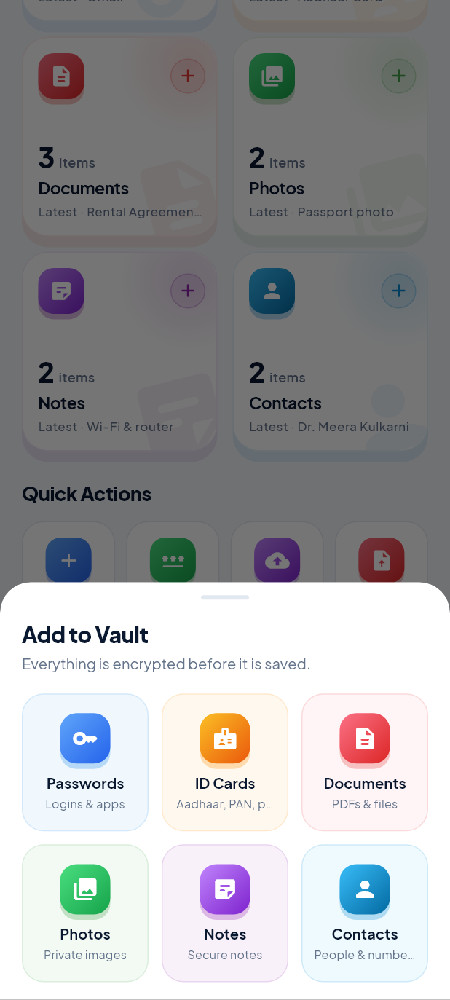 | 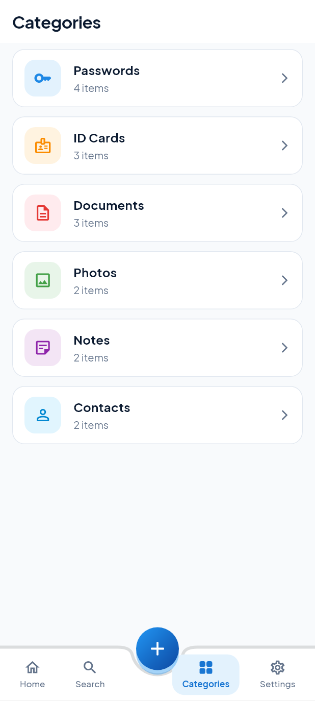 | 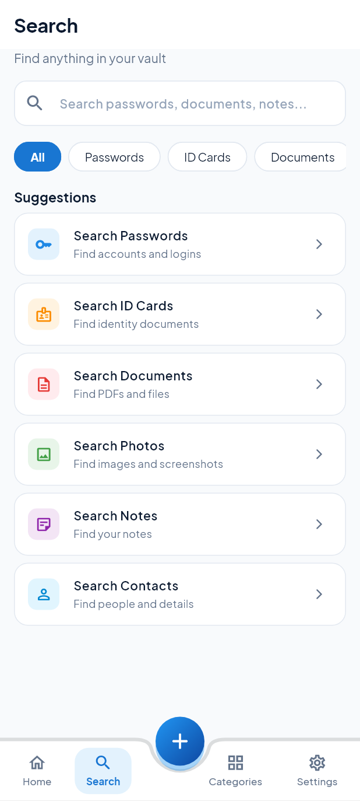 |

### Items

| Passwords | Password details | New password | Bank card |
| :---: | :---: | :---: | :---: |
| 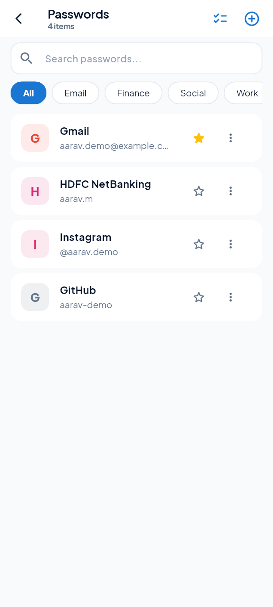 |  | 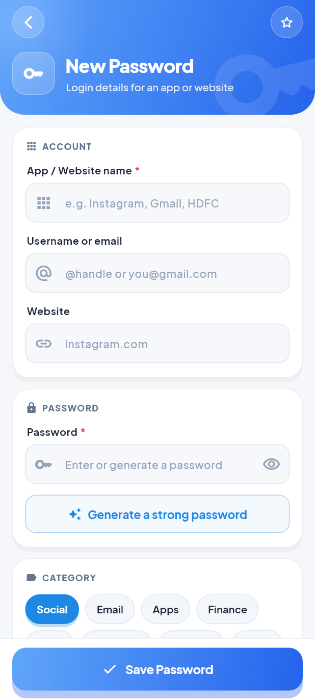 | 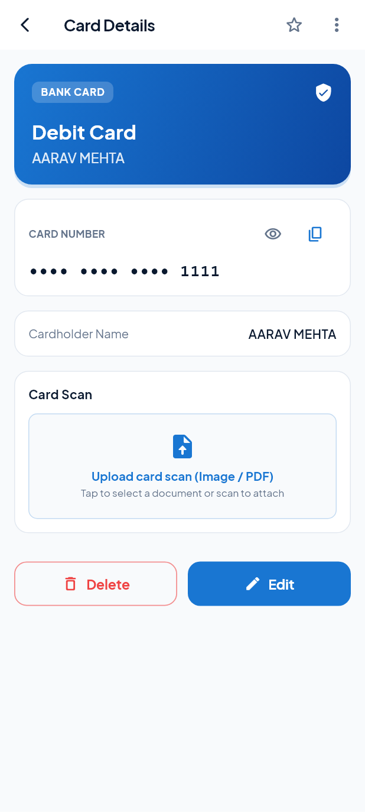 |

| Documents | Secure note | Contacts |
| :---: | :---: | :---: |
| 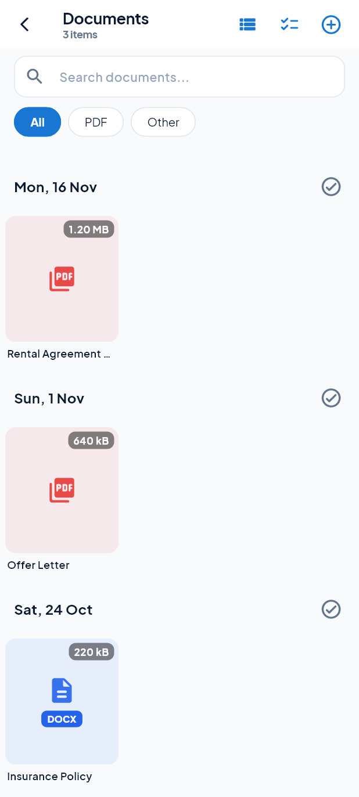 | 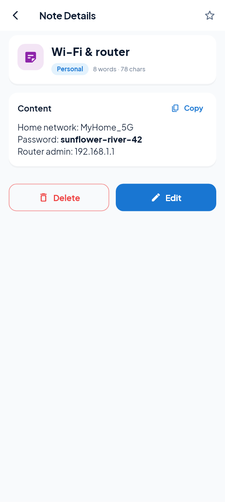 | 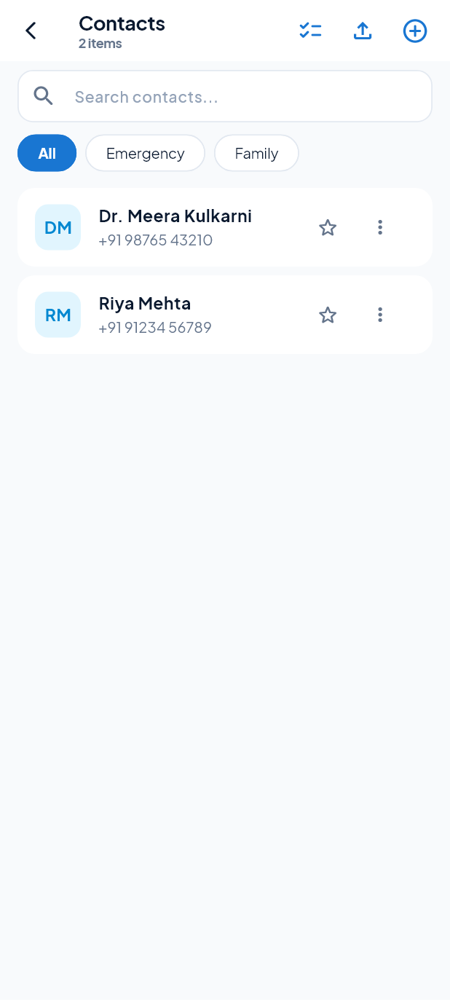 |

### Settings & backup

| Settings | Backup & Restore | Google Drive backup |
| :---: | :---: | :---: |
| 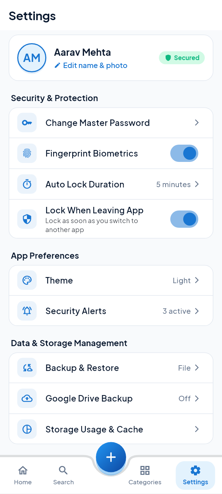 | 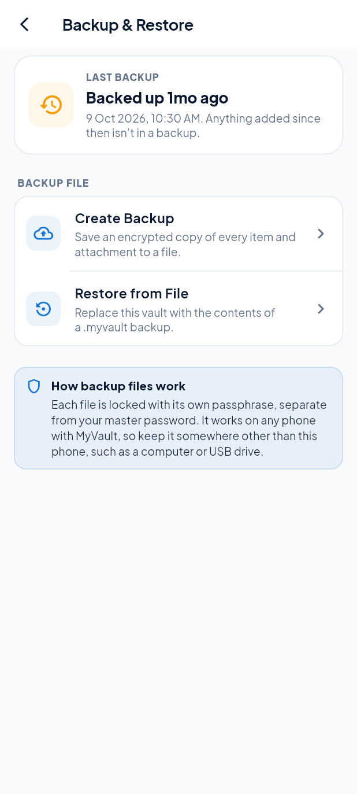 | 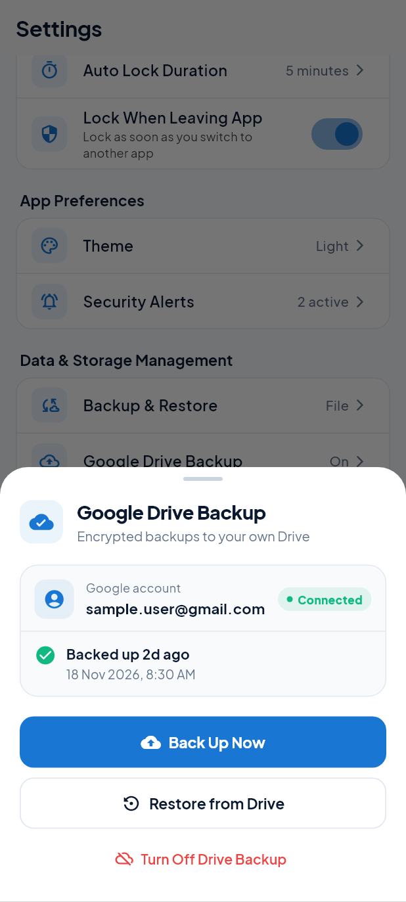 |

### Dark theme

| Home | Password details | New password | Google Drive backup |
| :---: | :---: | :---: | :---: |
| 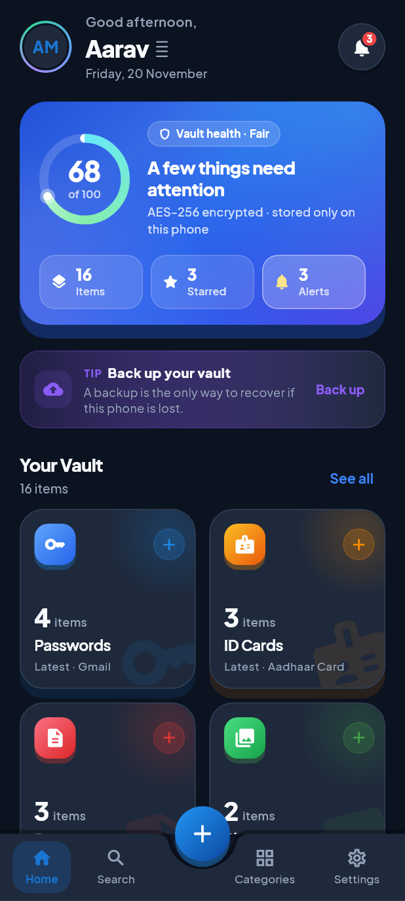 | 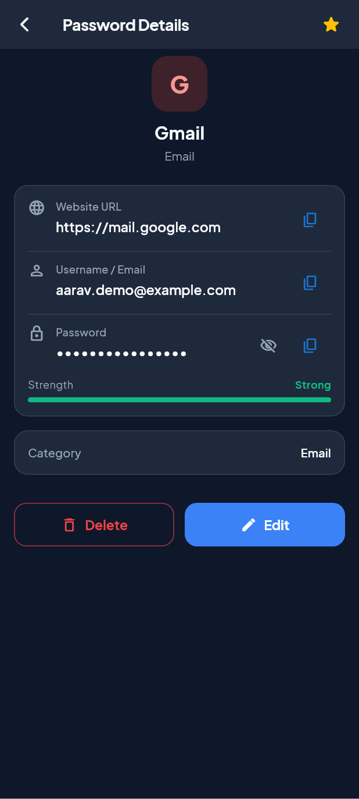 | 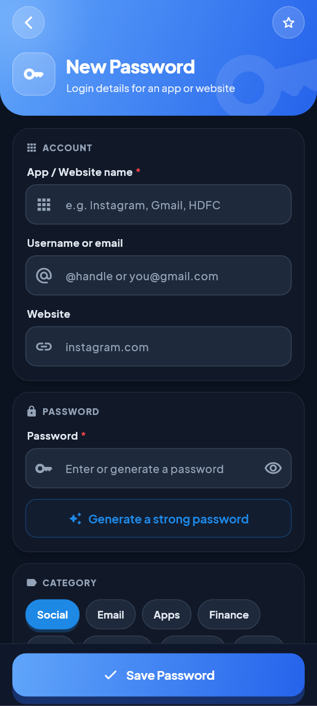 | 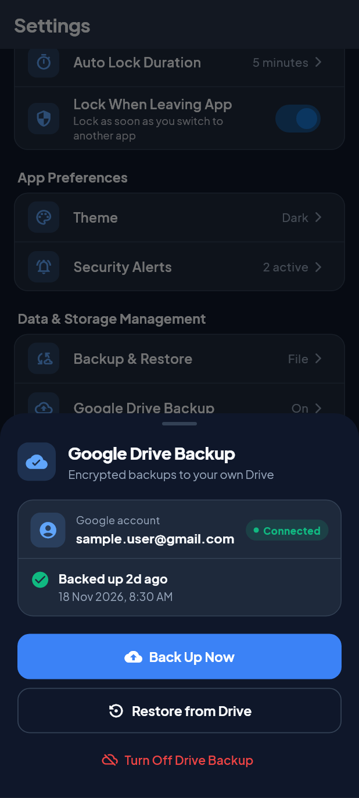 |

## How your data is protected

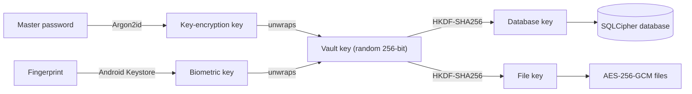

- **One random vault key.** Your data is encrypted with a random 256-bit key. Your master password only unlocks that key, so changing the password doesn't re-encrypt the vault.
- **Slow to guess.** The master password is stretched with **Argon2id** (19 MiB of memory, 2 passes), which makes guessing it expensive.
- **Encrypted database.** Records live in a **SQLCipher** database (AES-256, with every page authenticated).
- **Encrypted files.** Every attachment is encrypted separately with **AES-256-GCM**, using a fresh nonce for each file.
- **Separate keys.** The database key and the file key are each derived from the vault key with HKDF-SHA256, and both are wiped from memory when the vault locks.
- **Fingerprint unlock** uses a key that never leaves the Android Keystore and needs a fresh fingerprint each time.
- **Brute-force lockout.** Wrong passwords trigger an increasing lockout, timed with a clock that changing the phone's date can't fool.
- **App hardening.** The app is screenshot-protected (`FLAG_SECURE`), Android's automatic cloud backup is off (`allowBackup="false"`), and sensitive copies are cleared from the clipboard.
- **Backup files** are locked with their own passphrase (Argon2id + AES-256-GCM), and any tampering is detected on restore.

## Where your data lives

The primary store is **the phone itself**, in MyVault's private app storage. Other apps can't read it, and it's removed when the app is uninstalled.

| Data | Location | Protection |
| :--- | :--- | :--- |
| Records (passwords, IDs, notes, contacts, document details) | `app_flutter/vault_secure/myvault_encrypted.db` | SQLCipher, AES-256 |
| Attachments (scans, photos, PDFs) | `app_flutter/vault_encrypted_files/` | AES-256-GCM, one file at a time |
| Wrapped keys and settings | Android secure storage | Android Keystore |

**Google Drive backup is optional and off by default.** When it's on, Drive receives a single encrypted `.myvault` file. It never receives your master password, the vault key, or readable data. Drive is used only for backup and restore, never as live storage.

## Getting started

### Requirements

- Flutter **3.47** or later (Dart 3.13)
- Android SDK with an Android **7.0+** (API 24) device or emulator

### Run

```bash
git clone https://github.com/Krish1712204/Myvault.git
cd Myvault
flutter pub get
flutter run
```

### Release build

Release builds need your own signing key. Create `android/key.properties`:

```properties
storeFile=release.keystore
storePassword=<your store password>
keyAlias=<your key alias>
keyPassword=<your key password>
```

```bash
flutter build apk --release
```

`key.properties` and `*.keystore` are git-ignored. **Never commit them.** For a local test build without a release key, pass `--android-project-arg=myvault.allowDebugSigning=true`.

### Google Drive backup (optional)

Drive backup needs a Google Cloud project with the Drive API turned on and an Android OAuth client registered for your signing key. See [docs/GOOGLE_DRIVE_BACKUP_SETUP.md](docs/GOOGLE_DRIVE_BACKUP_SETUP.md). The rest of the app works without it.

## Project structure

```
lib/
├── core/                 # App-wide services
│   ├── backup/           # .myvault backup format and Google Drive backup
│   ├── brand/            # Logo, drawn in code
│   ├── database/         # SQLCipher database and schema
│   ├── security/         # Key derivation, Keystore biometrics, clipboard, clock
│   ├── storage/          # Encrypted file storage and thumbnails
│   ├── theme/            # Light and dark Material 3 themes
│   └── ui/               # Formatting and friendly error messages
├── features/
│   ├── auth/             # Welcome, create vault, unlock, auto-lock
│   ├── dashboard/        # Home, vault health, tips
│   ├── categories/       # Category lists and document grid
│   ├── search/           # Vault-wide search
│   ├── settings/         # Settings, Backup & Restore, Google Drive backup
│   └── vault_items/      # Add, edit and detail screens for every item type
└── shared/               # Shared widgets, navigation and state
android/                  # Native Keystore, PDF thumbnails, clipboard and clock channels
tool/                     # Screenshot renderer and app-icon generator
test/                     # Unit and widget tests
```

**Built with** [Riverpod](https://riverpod.dev), [go_router](https://pub.dev/packages/go_router), [sqflite_sqlcipher](https://pub.dev/packages/sqflite_sqlcipher), [cryptography](https://pub.dev/packages/cryptography), [flutter_secure_storage](https://pub.dev/packages/flutter_secure_storage) and [google_sign_in](https://pub.dev/packages/google_sign_in) + [googleapis](https://pub.dev/packages/googleapis).

## Testing

```bash
flutter analyze                     # static analysis
flutter test                        # 166 unit and widget tests
flutter test tool/screenshots.dart  # re-render the screenshots into build/screenshots/
```

The tests cover:
- key derivation, checked against known test vectors
- backup and restore round trips, including tampered and incomplete files
- data integrity
- vCard import
- vault alerts
- regression tests for fixed bugs

## Documentation

- [Storage architecture](docs/STORAGE_ARCHITECTURE.md): database schema and file encryption
- [Key management](docs/KEY_MANAGEMENT.md): key hierarchy, biometrics and locking
- [Security audit report](docs/SECURITY_AUDIT_REPORT.md)
- [Google Drive backup setup](docs/GOOGLE_DRIVE_BACKUP_SETUP.md)
